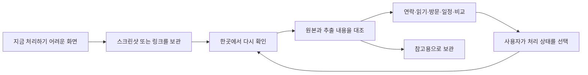

# Scrave 통합 기획과 총괄 작업판

작성일은 2026-10-09이며, 총괄은 현재 Codex 대화 세션 `01a11ce1-2831-7a63-8d44-c67445a0d34e`입니다. 사용자가 이 세션에 기존 논의 통합과 지휘를 요청했습니다. 이 문서는 로컬 기획 기준이며, 제품 기능의 구현·배포 완료를 뜻하지 않습니다.

## 사용자가 확정한 문제

사람은 당장 링크를 저장하거나 전화번호를 옮기는 일이 번거로울 때 화면을 캡처합니다. 다른 서비스에 저장한 자료는 흩어지고 다시 보지 않게 되므로, 나중에 한꺼번에 확인할 수 있는 스크린샷을 임시 보관 수단으로 씁니다. Scrave는 이 행동을 지원합니다. 이미지와 링크를 주요 입력으로 유지하면서, 캡처한 내용을 다시 찾고 필요한 행동으로 연결하는 데 초점을 둡니다. [High: 2026-10-09 현재 사용자 발언]

앞선 이 세션의 ‘개인 잡지형 이미지·링크 수집 앱’ 기획은 제품 전체 정의로 사용하지 않습니다. 보기 편한 카드와 컬렉션은 재열람을 돕는 화면 구성으로 남깁니다.

## 제안하는 전체 흐름

분류·폴더 선택·메모 작성을 저장의 필수 조건으로 만들지 않습니다. 분석에 실패해도 원본을 보관하며, 한 캡처에 전화번호·날짜·장소·링크가 함께 있으면 복수 행동을 제안합니다. 사용자가 저장한 이유를 단정하지 않고, 제안한 행동을 수정하거나 무시할 수 있게 합니다. [Medium: 기획 제안]

## 다른 논의와의 통합

| 근거와 날짜 | 확인한 내용 | 통합 후 역할 |
|---|---|---|
| `docs/PRODUCT_SPEC.md`, 2026-04-23 | 장소·텍스트 분류와 검색·지도 흐름을 설명합니다. | 원본 보관·추출·재탐색의 기반으로 활용합니다. 문서의 완료 표시는 현재 실사용 검증과 구분합니다. |
| `origin/main:DECISIONS.md`, 2026-07-30 | 링크 하나도 입력으로 받고 원문·작성자·이미지 묶음을 보존하도록 정했습니다. | 링크와 스크린샷을 동등한 입력으로 다루며 출처를 유지합니다. |
| `docs/specs/2026-09-26_capture-to-guide_v1.md`, 2026-09-26 | 장소 캡처를 가이드 초안으로 만드는 웹 기능을 설명합니다. | 방문하려고 저장한 자료를 활용하는 한 경로로 배치합니다. |
| Studio Soluta의 `2026-09-26_scrave_screenshot-taste-app_v1.md` | 취향에 맞는 선택을 돕는 기획과 당시 보류 기록이 있습니다. | 비교·결정 단계의 확장 후보로 둡니다. 당시 보류를 현재 기획 요청의 중단 지시로 해석하지 않습니다. |
| [사용자 Pinterest 참고](https://pin.it/7krqdkwh3), 2026-10-09 직접 화면 확인 | 큰 제목·비정형 카드·밝은 화면과 주황색 강조를 확인했습니다. | 정보 위계와 재열람의 참고로 씁니다. 현재 `DESIGN.md`의 어두운 테마를 승인 없이 교체하지 않습니다. |
| 현재 사용자 설명, 2026-10-09 | 당장 하기 어려운 행동을 캡처해 두고 나중에 한곳에서 확인하려는 문제를 설명했습니다. | 전체 제품의 우선 기준으로 적용합니다. |
| 다른 Codex 세션의 사용자 발언, 2026-10-09 04:00 한국시간 | 정보를 다시 꺼내기·발견·취향 연결·활용을 아우르는 시스템과 분석 결과를 보여 주는 앱 화면을 요청했습니다. | 처리할 일이 없는 캡처에도 재발견과 취향 연결의 가치를 유지합니다. |

이 표는 기획 자료와 원격 코드 확인을 통합한 것입니다. 과거 시장 조사 문서의 경쟁사·매출·운영체제 기능 주장은 이번 기획의 검증 근거로 재사용하지 않습니다.

## 네 가지 활용 경험

전체 제품은 다시 찾기, 재발견, 취향 연결, 행동으로 활용하기를 함께 지원하는 방향으로 기획합니다. 사용자가 분명한 목적을 가지고 찾으면 검색으로 원본에 도달하게 하고, 목적 없이 둘러볼 때는 이전에 저장한 자료를 다시 만날 수 있게 합니다. 취향 연결은 저장 사실만으로 선호를 단정하지 않고, 사용자가 남긴 이유와 실제 선택을 근거로 삼습니다. 참고·비교·반대 사례를 모은 캡처도 있을 수 있기 때문입니다.

재발견 기능의 빈도와 묶는 기준은 제안 단계입니다. 우선 사용자가 직접 여는 ‘다시 보기’ 흐름으로 검증하고, 자동 알림과 자동 취향 판단은 별도 검증 후 정합니다. 기존 작품 분석 화면은 ‘이 그림을 왜 남겼는지 떠올리고 작업에 활용하기’의 사례이며, 연락처 캡처와 함께 같은 보관·검색 기반을 사용합니다.

## 구체적인 사용 장면

| 캡처한 장면 | 미뤄 둔 행동의 예 | 다시 열었을 때 필요한 기능 | 완료 판정 |
|---|---|---|---|
| 전화번호가 적힌 안내 | 번호를 옮기거나 연락하려고 저장합니다. | 원문과 추출 번호를 함께 보여 주고 복사·연락처 작성·전화 앱 연결을 제안합니다. | 전화 앱을 열었다는 사실과 실제 연락 완료를 구분합니다. |
| 글·영상·상품 링크 | 지금 읽거나 비교하기 어려워 저장합니다. | 원문으로 돌아가기와 관련 자료 묶기를 제공합니다. 주소가 없으면 검색 후보임을 표시합니다. | 링크 열기와 읽기·구매 완료를 구분합니다. |
| 장소·메뉴 | 나중에 방문하거나 동선을 정하려고 저장합니다. | 장소 확인·지도 열기·기존 가이드 기능을 연결합니다. | 지도 열기를 방문 완료로 처리하지 않습니다. |
| 행사·예약 안내 | 일시를 옮기거나 일정을 검토하려고 저장합니다. | 추출한 날짜를 원본과 대조한 뒤 일정 작성 화면으로 연결합니다. | 일정 저장 성공을 확인하거나 사용자가 직접 표시합니다. |
| 디자인·문장·아이디어 | 필요할 때 참고하려고 저장합니다. | 이미지·추출 텍스트 검색과 원문 확인을 제공합니다. | 처리 완료를 강요하지 않고 참고용으로 남깁니다. |

전화·연락처·일정 연동은 아직 기능 확정을 위한 제안이며, 운영체제별 동작과 권한은 구현 전 검증 대상입니다. 스크린샷에서 보이지 않는 원본 링크를 복원했다고 주장하지 않습니다.

## 화면과 정보 구조 제안

앱의 첫 화면은 다시 확인할 캡처를 모아서 보여 주며, 전체 자료 검색을 바로 사용할 수 있게 합니다. 자료의 종류에 따른 장소·텍스트 분류는 유지하되, ‘연락하기’, ‘읽기’, ‘방문하기’ 같은 행동 제안은 별도 정보로 다룹니다. 저장한 목적이 다른 자료를 한 종류의 할 일 목록으로 강제하지 않습니다.

상세 화면은 원본, 추출한 정보, 가능한 행동 순서로 구성하고, 행동 버튼에는 검토할 내용을 드러내 사용자가 선택할 때 실행합니다. 처리 상태와 원본 보존 상태를 분리하여, 처리를 마쳐도 자료를 다시 찾을 수 있게 합니다. 한 캡처에서 여러 행동을 처리할 때 각 행동의 상태를 따로 유지하는 방향을 검토합니다.

사진 보관함에서 새 캡처를 가져오는 방식은 모바일 검증의 우선 과제입니다. ‘자동 수집’을 확정 문구로 쓰기 전에 접근 권한, 백그라운드 제약, 중복 입력, 기존 캡처 가져오기를 확인합니다. 초기 검증에서는 사용자가 고른 이미지 가져오기와 링크 입력을 기준으로 삼습니다.

## 첫 검증 범위와 제외 범위

첫 검증은 원본 보관 → 한곳에서 찾기 → 추출 내용 확인 → 행동 선택의 연결에 집중합니다. 전화번호와 링크는 이번 사용자 설명에 직접 등장한 사례이므로 우선 검증하고, 기존 장소·지도 흐름을 회귀 확인합니다. 일정과 상품 비교는 같은 구조로 이어질 수 있도록 설계하지만 초기 구현 범위는 검증 후 정합니다.

저장할 때마다 질문하거나 분류를 요구하지 않습니다. 모든 캡처에 기한을 붙이거나 반복 알림을 만들지 않습니다. 자동 연락·예약·구매·메시지 발송은 첫 범위에 넣지 않습니다. 알림은 사용자가 다시 볼 시점을 지정하는 방식부터 검토하며, 실제 재열람 문제를 관찰한 뒤 자동 제안을 판단합니다.

## 총괄 작업판

| 순서 | 책임과 작업 | 산출물·수락 기준 | 현재 상태 |
|---|---|---|---|
| 1 | 총괄이 기존 논의·결정·코드를 통합합니다. | 출처와 날짜, 확인된 구현과 제안을 구분한 본 문서를 만듭니다. | 기획·원격 코드·다른 세션의 사용자 원문을 대조했습니다. |
| 2 | 총괄이 기존 작업의 소유권과 겹침을 정리합니다. | 기본 작업 폴더와 별도 브랜치의 변경 파일·담당 범위를 대조합니다. | 별도 작업 담당 세션을 식별했습니다. 작품 상세 구현은 기존 담당 범위로 두며, 직접 메시지 전달은 확인하지 못했습니다. |
| 3 | 제품 설계 담당이 캡처별 행동 흐름을 만듭니다. | 연락·읽기·방문·참고 사례에서 원본부터 다음 행동까지 연결하며, 제안 오류를 고칠 수 있어야 합니다. | 아직 새 구현 작업자를 배정하지 않았습니다. |
| 4 | 모바일 담당이 입력 경로를 검증합니다. | 선택 이미지 가져오기·공유 입력·재실행·중복 처리와 권한 거부 동작을 실기기에서 확인합니다. | 담당 배정 전입니다. |
| 5 | 데이터 담당이 최소 저장 구조를 제안합니다. | 자료 종류와 행동·상태를 구분하고, 기존 캡처와 지도·가이드의 호환성을 검증합니다. | 설계 전이며 데이터 구조를 변경하지 않았습니다. |
| 6 | 검증 담당이 실제 사용을 확인합니다. | 저장한 자료 재탐색, 원문 대조, 행동 연결, 상태 보존을 확인합니다. 외부 앱 실행과 행동 완료를 구분합니다. | 실행 전입니다. |

워커에게는 목표·수락 기준·검증 방법과 소유 파일을 지정하며, 하위 위임을 허용하지 않습니다. 총괄이 환경에서 결과를 직접 확인하고 채택합니다. 기존 다른 세션에 대한 직접 메시지 전달 수단은 아직 확인하지 못했으므로, 읽은 기록만으로 작업 통제가 완료됐다고 보고하지 않습니다.

## 착수 시 확인한 저장소 상태

2026-10-09에 `git fetch origin`, `git log origin/main -5`, 열린 변경 요청 목록을 확인했습니다. 원격 기준은 `c2d7a7f`이며, [가이드 초안 기능 변경 요청 25](https://github.com/ssongji1122/capsave/pull/25)가 병합된 상태입니다. 열린 변경 요청은 조회 시점에 0건입니다. [High: 직접 조회]

기본 작업 폴더 `/Users/ssongji/Developer/Workspace/scrave`는 `main`의 `a5271de`를 가리키며 지도·검색·게스트 흐름 등 기존 수정 파일 15개와 미추적 파일이 있습니다. 이 변경을 되돌리거나 총괄 문서 작업에 포함하지 않습니다.

별도 작업 폴더 `/Users/ssongji/Developer/Workspace/scrave-capture-intent-1009`는 `feat/capture-intent-experience`의 `c2d7a7f`를 가리킵니다. 첫 조회 후 `_dogfood/`와 `node_modules` 항목이 새로 나타나 병행 작업의 가능성을 확인했습니다. 소유 세션 확인 전 같은 기능을 새로 구현하지 않습니다.

담당 세션은 `01a11b91-5d3a-7951-8c14-c82530ba9474`이며, 04:02 한국시간에 해당 작업 폴더를 만들었습니다. 원본 사본 `source.jpg` 137,157바이트와 기존 분석 결과 `codex-analysis.json` 1,553바이트의 존재를 직접 확인했습니다. 저장 이유·검색·다시 볼 시점·메모 내보내기는 담당 에이전트가 제안한 구현 범위이며 사용자 세부 승인으로 기록하지 않습니다. 이 감사 시점에는 입력 자산 준비를 확인했으며 화면 완성·검증 완료는 별도 확인 대상입니다.

원격 `CaptureCategory`는 `place | text`이며, `CaptureItem`에는 원문·추출 텍스트·링크·장소·태그 등 필드가 있습니다. 이 타입에는 별도 행동·처리 상태 필드가 없습니다. 이 관찰은 해당 타입에 한정하며, 저장소 전체에 유사 기능이 없다는 뜻은 아닙니다. 원격 가이드 생성·저장 함수와 라우트의 존재는 확인했지만 이번 조사에서 유료 생성이나 운영 서비스 동작을 실행하지 않았습니다.

저장소는 공개 상태입니다. 이번 산출물은 로컬에만 두며, 공개 변경 요청·푸시 전에 공개할 문서와 내용을 확정해야 합니다. 비밀정보와 다른 세션의 원문 전체는 문서에 복사하지 않습니다.

## 검증 기준

저장 개수는 제품 성공의 단독 기준으로 쓰지 않습니다. 저장에 필요한 단계 수, 다시 찾는 데 걸린 시간, 제안한 행동의 수정 빈도, 실제로 다음 행동까지 이어진 사례를 관찰합니다. 관측 전 목표 달성률이나 효과 수치를 만들지 않습니다.

첫 검증에서는 읽기 링크·전화번호·장소·참고 이미지·번호 오인식·원문 링크 누락 사례를 포함합니다. 분석 실패에도 입력을 잃지 않아야 하고, 앱을 다시 열어도 저장 자료와 사용자가 확정한 상태가 남아야 합니다. 알 수 없는 정보를 확정한 행동으로 제시하지 않아야 합니다.

좋은 관점에서는 이미 반복하는 캡처 행동을 입력으로 활용할 수 있습니다. 반대 관점에서는 저장 후 매번 정리와 확인을 요구하면 사용자의 부담이 늘 수 있으므로 필수 입력을 최소화합니다. 창의적 관점에서는 한 장씩 정리하는 화면에 더해, 사용자가 원할 때 모아 둔 캡처를 한 번에 확인하고 처리하는 흐름을 비교 검증할 수 있습니다.

## 근거 경로

- [기존 제품 구조 문서](../PRODUCT_SPEC.md)를 읽었습니다.
- [현행 디자인 기준](../../DESIGN.md)을 읽었으며 이번 작업에서 수정하지 않았습니다.
- [가이드 설계 원문](../../../scrave-capture-intent-1009/docs/specs/2026-09-26_capture-to-guide_v1.md)을 확인했습니다.
- [기존 취향 도구 기획](../../../studio.soluta-c2-0930/docs/strategy/2026-09-26_scrave_screenshot-taste-app_v1.md)을 확인했습니다.
- 전역 `action_tracker.md`의 Scrave 항목은 2026-06-10 감사 기록이며, 이번 제품 방향을 정하는 근거로 쓰지 않았습니다.
- [다른 세션 사용자 발언 원문](/Users/ssongji/.codex/sessions/2026/10/08/rollout-2026-10-08T21-51-14-01a11b91-5d3a-7951-8c14-c82530ba9474.jsonl:260)을 직접 대조했습니다. 이 경로는 로컬 운영 근거이며, 공개 배포 문서에서는 제외합니다.

## 2026-10-09 추가 구체화와 기획 검증

사용자가 여행 입구의 예약 제시, 캡처에서 장소 식별, 후기 확인, 내부 보관, 선택적 지도 내보내기를 설명했습니다. 이를 [문제·경험·사업 기획](2026-10-09_scrave-problem-experience-and-business.md)과 [경험 기획판 2판](../../_dogfood/2026-10-09_scrave_saved-information-experience_v2.html)에 반영했습니다. 첫 검증은 여행 원본의 기기 내 보관·재실행·확대이며, 이후 장소 식별과 후기 확인을 검증하도록 제안합니다. 기존 검증 항목도 유지합니다.

기획판은 오프라인 디자인 검사를 통과했습니다. Chrome 자동 검사에서 네 장면 전환, 근거 창 열기·닫기, 예시 저장과 새로고침 후 유지, 화면 너비 390·768·1440에서 가로 넘침 없음과 페이지 오류 없음을 확인했습니다. 네트워크를 끈 상태에서 검사했으며, 이는 설명용 HTML의 동작 검증입니다. 실제 앱의 오프라인 원본 저장이나 검색·분석 동작을 검증한 결과가 아닙니다. 모바일의 첫 화면과 장면 구성 화면도 이미지로 직접 확인했습니다. 문체 검사에는 오류 없이 표현 경고가 남았으며, 기술적 한계 설명은 유지했습니다.

기존 마케팅 수업의 조사·판단·제작·측정 구조와 사용자 조사 수업의 실제 사건 관찰을 적용했습니다. 광고·데이터 활용은 사업 가설과 정책 조건으로 정리했으며 구현하거나 외부에 전달하지 않았습니다. 이번 작업은 기획 문서와 설명용 HTML에 한정했습니다.
