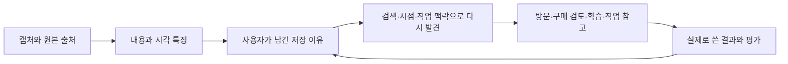

# 캡처의 이유를 다시 쓰는 화면

## 목표와 완료 기준

2026-10-09 사용자 요청에 따라, 캡처를 한 이유에서 재탐색·발견·취향·활용으로 이어지는 제품 방향을 기존 기획과 대조합니다. 2026-10-08에 Codex로 실제 분석한 작품 한 장을 앱 안에서 보고, 사용자가 직접 이유를 남기고 다시 찾으며 메모로 꺼낼 수 있는 로컬 화면을 만듭니다.

- [x] 원격 main의 결정 원장과 최근 기능을 확인합니다.
- [x] 실제 원본과 분석 결과를 작업 폴더에 보존합니다.
- [ ] 저장 이유와 다시 볼 시점을 브라우저에 보관하고 새로고침 뒤 복원합니다.
- [ ] 관찰한 특징과 사용자가 선택한 취향을 구분합니다.
- [ ] 실제 기록만 검색·재탐색하고 출처를 포함한 참고 메모를 내보냅니다.
- [ ] 데스크톱과 모바일 화면, 키보드, 저장 실패를 검증합니다.

화면 구현과 검증은 에이전트가 수행하고, 제품 방향의 최종 채택은 사용자가 판단합니다. 공개 저장소에 올리는 단계와 계정 데이터 구조 변경은 이번 로컬 검토 범위에 포함하지 않습니다. 원본을 포함한 파일은 로컬 검토용입니다.

## 현재 근거

조회 기준은 원격 main `c2d7a7f`입니다. 원래 로컬 main에는 병렬 작업의 수정 파일이 있어 별도 작업 공간을 만들었습니다.

| 기존 기능 또는 기획 | 확인한 근거 | 이번 작업과의 관계 |
|---|---|---|
| 원본·작성자 보존, 검증 전 수집 상태 | `DECISIONS.md`, 2026-07-30 | 캡처 사실과 해석을 분리하고 원본을 다시 열 수 있게 합니다. |
| 장소·텍스트 분석과 검색 | `packages/shared/src/ai/parse-result.ts`, `apps/web/src/components/captures/CaptureCard.tsx` | 기존 분류를 바꾸지 않고 작품에 관한 세부 분석을 별도로 보존합니다. |
| 장소별 후기·영상 선별 | `apps/web/src/lib/review-curation.ts`, PR #22·#23 | 다음 행동을 돕는 기존 사례입니다. 작품에 장소 후기를 억지로 연결하지 않습니다. |
| 캡처로 가이드 초안 생성 | `docs/specs/2026-09-26_capture-to-guide_v1.md`, PR #25 | 장소는 여행 가이드로, 이번 작품은 출처가 있는 참고 메모로 활용합니다. 가이드 영구 저장·공유 후속 단계와 혼동하지 않습니다. |
| 지도 앱 선호 | `apps/web/src/contexts/UserPreferencesContext.tsx` | 현재의 설정은 지도 앱 선택입니다. 콘텐츠 취향 기록과는 별개입니다. |
| 취향을 근거로 후보 판단 | studio.soluta의 `docs/strategy/2026-09-26_scrave_screenshot-taste-app_v1.md` 사본 | 9월 제안은 보류 상태의 초안입니다. 이번 사용자의 통합 시스템 방향을 우선하며, 옛 보류를 현재 개발 금지로 해석하지 않습니다. |

다른 대화의 전문은 확보하지 못했습니다. 현재 사용자가 말한 비전과 위 저장소 근거를 기준으로 합니다. 개인 메모의 `action_tracker.md` 해당 검색에서는 이번 비전에 관한 실행 절차를 찾지 못했습니다.

## 하나의 기록이 다음 행동까지 가는 구조

분석기는 내용과 특징을 읽는 역할을 합니다. Codex 또는 Gemini가 추출한 정보에서 저장 이유를 추정할 수는 있지만, 사용자가 확인하기 전에는 취향으로 확정하지 않습니다. 캡처를 저장했다는 행동만으로 구매 의사·호감·방문 의사를 단정하지 않습니다.

이번 기록에서는 작품명·재료·크기·계정이 캡처에 있는 사실이며, 색감·질감은 분석한 관찰입니다. 저장 이유는 처음에는 비어 있고 사용자가 직접 선택합니다. 다시 발견은 사용자 지정 시점 또는 작업 맥락으로 현재 보관한 기록을 보여 줍니다. 관련 자료가 한 장뿐인 상태에서 취향 점수나 관련 작품을 만들어 내지 않습니다.

## 이번 화면과 다음 단계

이번에는 `/capture-lab`에서 실제 작품 상세, 로컬 보관, 이유·메모 편집, 캡처 검색, 재탐색, 취향의 근거, 참고 메모 다운로드와 사용 기록을 확인합니다. 저장은 이 브라우저에만 적용하며 기존 계정 저장소와 동기화하지 않습니다. 다시 볼 날짜는 앱 내 목록 기준이며 푸시 알림이 아닙니다. 기존 분석 결과를 사용하므로 새 모델 호출은 없습니다.

다음 제품 단계는 원본 참조·분석 관찰·사용자 의도·활용 이력을 계정에 함께 저장하는 것입니다. 이후에는 공통 특징과 명시적 이유를 연결해 발견 후보를 보여 주되 추천 근거와 숨기기·정정 기능이 필요합니다. 장소는 이미 있는 지도·후기·가이드로, 학습은 다시 읽기·실습으로, 작품은 참고 모음과 작업 메모로 연결할 수 있습니다. 교차 분야 추천과 자동 알림은 실제 기록이 쌓인 뒤 별도로 검증합니다.

좋은 관점에서는 기존 지도와 가이드가 활용의 끝부분을 이미 담당합니다. 반대 관점에서는 캡처의 이유를 과하게 추론하면 사용자의 취향을 잘못 고정할 수 있습니다. 창의적 대안으로 주제별 폴더뿐 아니라 ‘해 보기·결정하기·참고하기’처럼 사용자가 하려던 행동으로 다시 찾게 할 수 있습니다.

## 검증 기록

구현 후 실제 명령과 화면 검증 결과를 이 절에 추가합니다.
